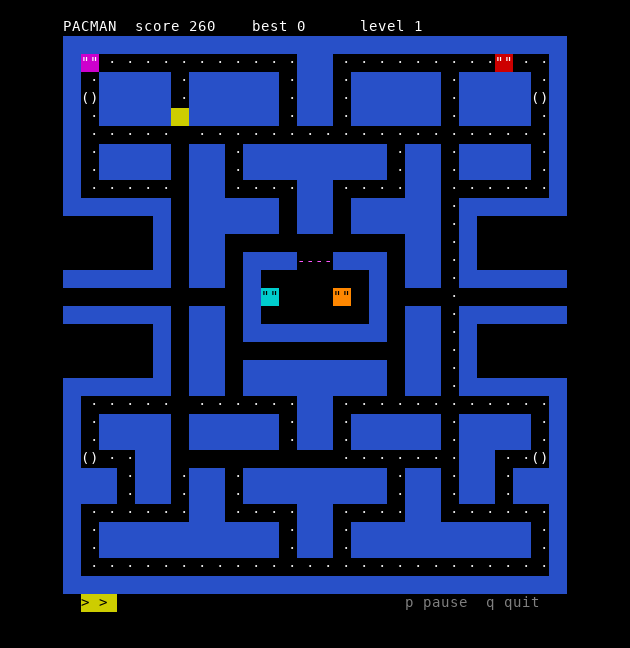

pacman for a terminal. one C file, no curses, no libraries, just the escape codes every terminal already understands

building

    make
    ./pacman

any C99 compiler on linux, the bsds or macos. the terminal has to be at least 56 columns by 34 rows

keys

arrows or wasd or hjkl to move, p pauses, q or esc quits. after a game over enter starts a new one

how it plays

the classic maze, 28 by 31 tiles. every tile is drawn two characters wide so the maze comes out about square on a normal font. walls are blue blocks, dots are 10 points, the four power pellets are 50 and make the ghosts blue for a while so you can eat them for 200 400 800 and 1600. the ghosts flash white just before they turn back

the ghosts are not random. they are the four from the arcade and each one picks its target its own way. red goes straight for you. pink aims four tiles in front of you. cyan takes the spot two tiles in front of you and doubles the line from red to it, so it gets more dangerous the closer red is. orange chases you until it gets within eight tiles and then runs back to its corner. at every junction a ghost takes the direction that brings it closest to its target and it never turns around on its own. they also switch between chasing and going back to their corners on a timer, 7 seconds of scatter and 20 of chase, again 7 and 20, then 5 more of scatter and chase for good, which is why they sometimes seem to give up on you. all of this goes by the pacman dossier, the best write up of the arcade logic there is

left out on purpose, everything moves in whole tiles and not pixels, an eaten ghost goes straight back to the house instead of floating home as eyes, and there is no fruit

you get 3 lives. clear the dots and the next level is faster and the blue time gets shorter. the best score is kept in ~/.pacman

how it draws

the program switches the terminal to raw mode and the alternate screen and hides the cursor. it keeps a copy of what every tile on the screen looks like and only sends the tiles that changed, a cursor move and a colour and two characters each, all collected into one buffer and written once per frame. a whole frame is usually a few hundred bytes so it runs fine over ssh. on exit or ctrl c it puts the terminal back the way it was

the game runs on a fixed step, about 12 moves a second on the first level. pacman moves every step, the ghosts skip every fifth step and blue ghosts move every other step

the same game runs inside serpentis360 on the xbox 360, https://github.com/ghidra-devos/serpentis360
