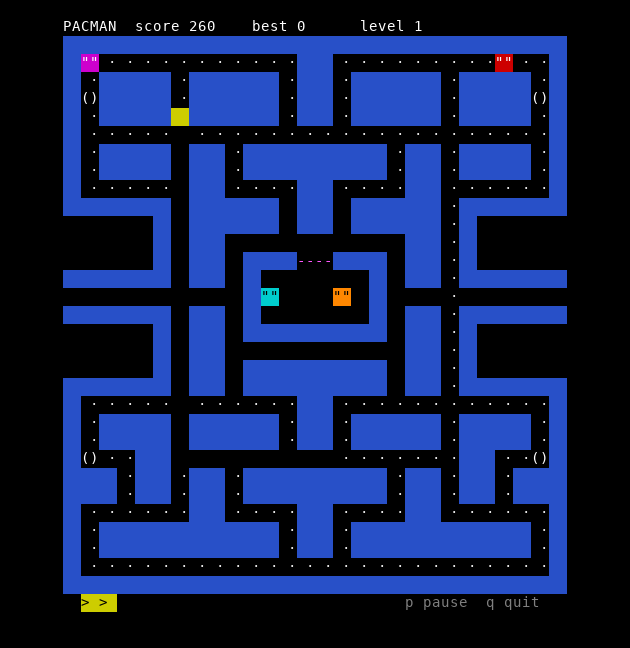

pacman for a terminal. One C file (pacman.c, 634 lines), no curses, no libraries, only ansi escape codes.

## what works

- the classic maze, 28 by 31 tiles, each tile two characters wide
- dots 10 points, four power pellets 50, ghosts eaten for 200 400 800 1600
- four ghosts with their own targeting: red chases you, pink aims four tiles ahead, cyan and orange follow their own rules
- 3 lives, levels that get faster with a shorter blue time
- best score in ~/.pacman
- redraws only the tiles that changed, one write per frame
- fixed step of about 12 moves a second on the first level

## build and run

    make
    ./pacman

Any C99 compiler on linux, the bsds or macos. The terminal has to be at least 56 columns by 34 rows.

Keys: arrows, wasd or hjkl to move, p pauses, q or esc quits, enter starts a new game after game over.

## not done

- everything moves in whole tiles, not pixels
- an eaten ghost goes straight back to the house instead of returning as eyes
- no fruit
- no sound
